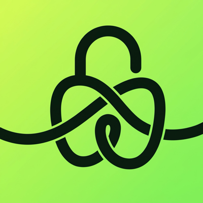
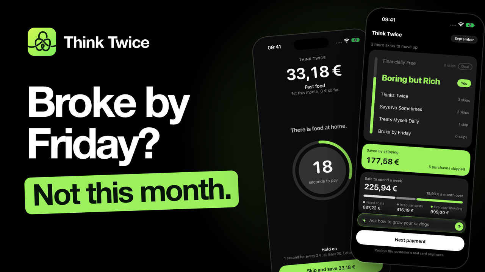
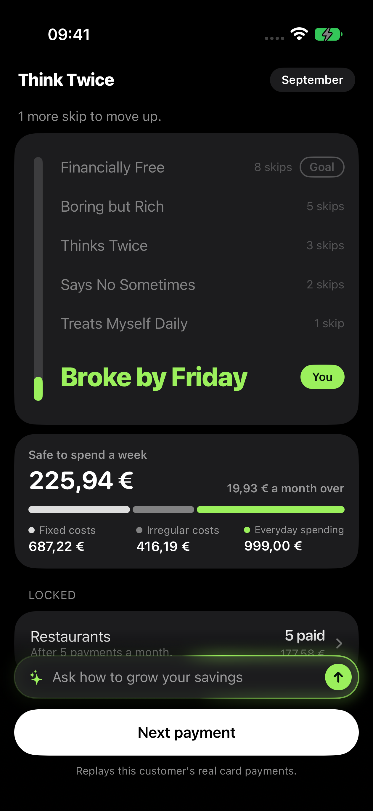
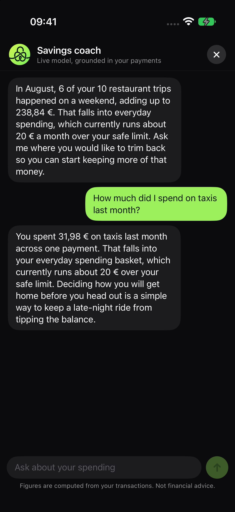
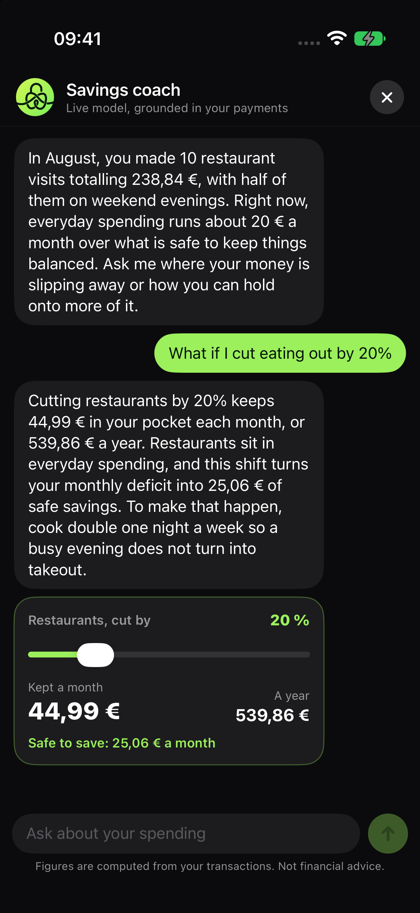
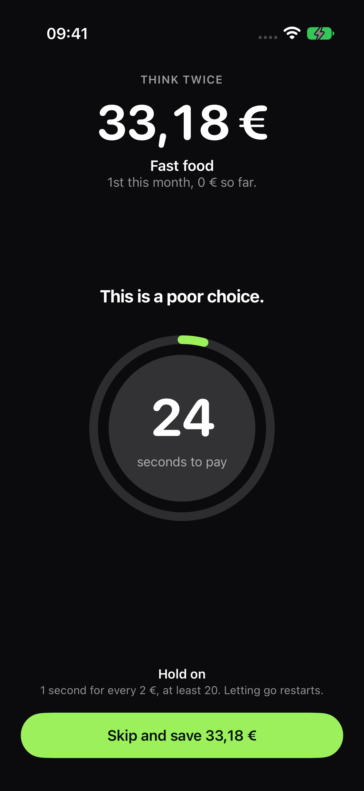
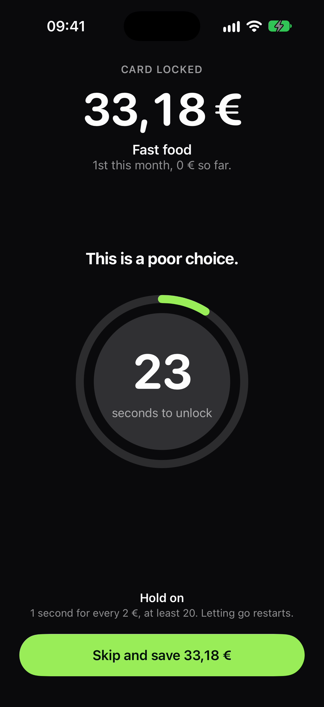
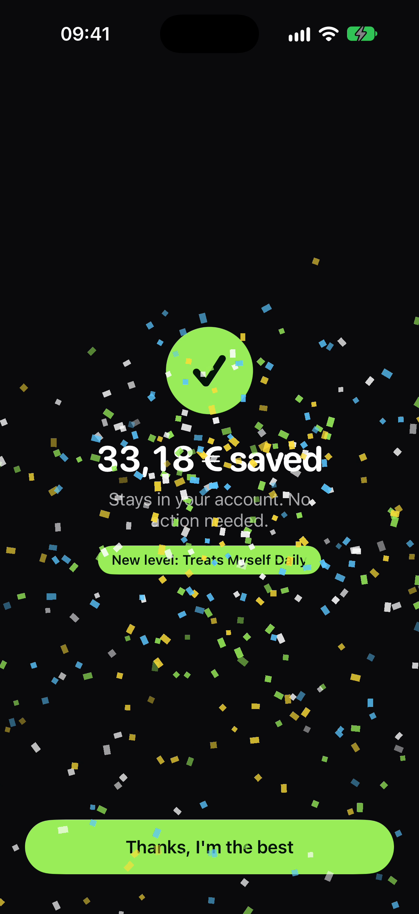
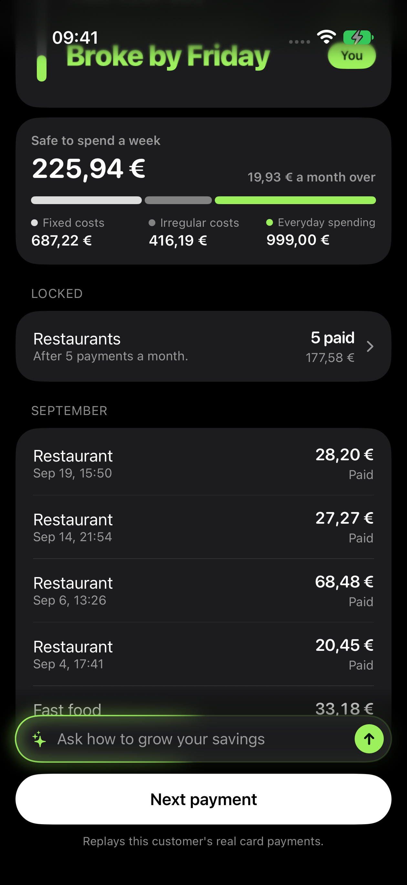
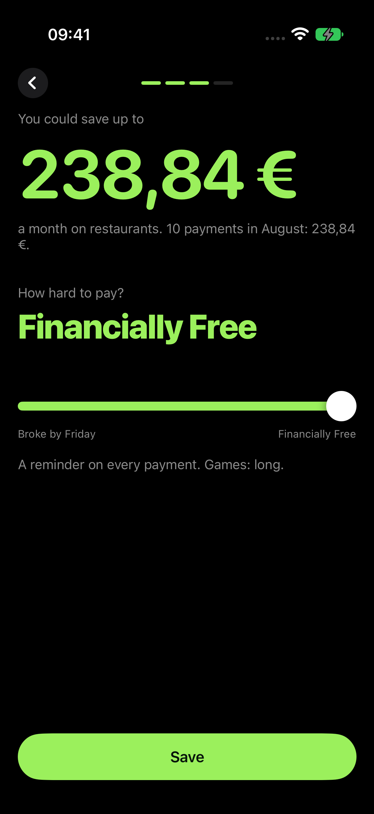

<p align="center"></p>

<h1 align="center">Think Twice</h1>

<p align="center"><b>Broke by Friday? Not this month.</b><br>A personal economic trainer for S-Bank customers, built for Junction 2026 (S-Pankki: Personal Economic Trainer).</p>

<p align="center">
  <a href="https://youtu.be/ZoQSPsUvayA">Watch the 50-second film</a> ·
  <a href="https://thinktwice.pgf.lv">Try the web demo</a> ·
  <a href="presentation/deck/deck.pdf">Pitch deck (PDF)</a>
</p>

[](https://youtu.be/ZoQSPsUvayA)

## What it does

Budgeting apps feel like homework, so people quit. Think Twice is a quick survival game about reaching Friday with money left, played with your real spending.

1. **Ask.** Chat with your own transactions in plain words. Every figure in a reply is computed from your data.
2. **Understand.** Every euro lands in one of three baskets: fixed costs, irregular costs, everyday spending. One number shows what is safe to spend this week.
3. **Play.** Pick the spending to cut. Past your own limit, the next payment starts a game. To pay, you have to really want it: hold the button while the app heckles you ("There is food at home."), or type out why you still want it.
4. **Win.** Skip, keep the money, take the confetti. Each skip is a step up six levels, from "Broke by Friday" to "Financially Free".

You can always pay. You just have to mean it.

## Screenshots

| Dashboard | Ask | What-if |
|---|---|---|
|  |  |  |

| The reminder | The hold game | Skip and save |
|---|---|---|
|  |  |  |

| Three baskets | Strictness |
|---|---|
|  |  |

## Tech

| | |
|---|---|
| Platform | iOS 17+, iPhone, portrait, dark only |
| UI | SwiftUI, no third-party packages |
| Project | Generated with [XcodeGen](https://github.com/yonaskolb/XcodeGen) from `project.yml` |
| Size | About 2 650 lines of Swift in 11 files, plus 22 unit tests |
| Data | One synthetic S-Bank customer: 593 transactions over 23 months, bundled as JSON |
| Model | Google Gemini (`gemini-flash-latest`) or Anthropic Claude, chosen by which key is present |
| Notifications | A real iOS local notification brings the reminder |

### How the coach works

Code does the maths, the model only words it.

1. `Money.swift` parses the question (month, category, percent, amount) and computes the answer: lookups, baskets, safe to spend, safe to save and what-if.
2. The computed figures go to the model together with the question. The prompt tells it to use those figures as given and to decline investment, loan, tax and betting questions.
3. Without a key or a network, the coach answers with the computed reply on its own.

Basket rule: rent and bills are fixed; a category paid less than once a month is irregular; the rest is everyday.

### The game

- Six strictness levels set the monthly limit (90 % of your usual count down to 0 %) and the game length.
- The hold game takes 1 second per 2 € (at least 20 seconds). Letting go restarts the timer.
- Each skip adds the payment to "Saved by skipping" and moves you up the ladder (0, 1, 2, 3, 5 and 8 skips).

### Source layout

| File | What it holds |
|---|---|
| `ThinkTwiceApp.swift` | App entry, notification setup |
| `AppModel.swift` | App state, session, launch switches for screenshots |
| `Logic.swift` | Tiers, limits, game lengths, levels |
| `Money.swift` | Transactions, baskets, lookups, what-if, question parsing |
| `Coach.swift` | Prompt, Gemini and Claude calls, offline replies, Keychain |
| `Dashboard.swift`, `ChatView.swift`, `Lists.swift` | Main screens |
| `Onboarding.swift` | Four setup screens: bank, strictness, card |
| `LockGame.swift` | Reminder, hold and type games, result screen |
| `Theme.swift` | Colours, type, shared components |
| `ThinkTwiceTests/LogicTests.swift` | 22 tests on the money logic |

## Run it

Built with Xcode 27.2.

```bash
brew install xcodegen
```

```bash
xcodegen generate
```

```bash
open ThinkTwice.xcodeproj
```

Run the `ThinkTwice` scheme on an iPhone simulator. Run the tests with Cmd+U.

To use the live model, set `GEMINI_API_KEY` or `ANTHROPIC_API_KEY` in the scheme's environment variables. The key is kept in the device Keychain after the first launch. Never commit a key: `ThinkTwice/Resources/claude-key.txt` must stay empty.

## Repository

| Folder | Contents |
|---|---|
| `ThinkTwice/` | The iOS app |
| `ThinkTwiceTests/` | Unit tests |
| `landing/` | The web demo at thinktwice.pgf.lv |
| `presentation/` | Pitch deck, submission text, cover, film sources |
| `tools/` | Data and icon scripts |

## Limits

- A hackathon prototype, not part of S-mobiili.
- One synthetic customer. English only. Not tested with users.
- Bank connection, card, payments and saved money are simulated.
- The basket rule is by frequency, so a trip counts as irregular even when it is a choice.
- No Android build yet.

---

Made by Progresful (Emils Plavenieks, Jurgis Kacens, Krisjanis Mezulis) 2026
